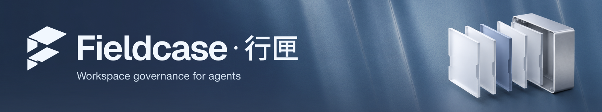

<h1 align="center">Fieldcase</h1>

<p align="center"><strong>Workspace rules that agents can follow across sessions.</strong></p>

<p align="center">Open-source workspace governance. Rules, authorization, progress, and pending work live in local files.</p>

<p align="center">
  <a href="README.md">简体中文</a> ·
  <a href="#quick-start">Quick start</a> ·
  <a href="#packs">Packs</a>
</p>

<p align="center"><code>0.1.0.0</code> · <a href="LICENSE">MIT</a></p>

<picture>
  <source media="(max-width: 720px)" srcset="cover/r4/fieldcase-banner-compact.png">
  
</picture>

## Quick start <a name="quick-start"></a>

### Agent-assisted installation

Copy the entire block below into an agent that can access the internet and read and write local files.

```text
Help me get started with Fieldcase 0.1.0.0. Download these two files into a separate temporary directory.

ZIP
https://github.com/rainydesignstudio/fieldcase/releases/download/0.1.0.0/fieldcase-0.1.0.0-en-US-release-01.zip

Verification manifest
https://github.com/rainydesignstudio/fieldcase/releases/download/0.1.0.0/fieldcase-0.1.0.0-en-US-release-01-manifest.json

Verify the ZIP against archive_sha256 in the manifest. Once the hash matches, unpack the ZIP and read its README.md. Follow the first-use guide and ask me to confirm the target workspace and my first small task.

This message authorizes downloading and unpacking in the temporary directory. Writes to the target workspace require my separate authorization after I approve the plan.
```

### Manual installation

1. Download the ZIP and verification manifest for the same language from the [0.1.0.0 release](https://github.com/rainydesignstudio/fieldcase/releases/tag/0.1.0.0).
2. Compare the ZIP's SHA-256 with `archive_sha256` in the manifest. Once they match, unpack the ZIP into a separate directory.
3. Give the agent the pack README, your target workspace directory, and one small task you want to start with.

Both routes require the agent to read and write the chosen local directories. The agent checks the target and plan, then writes with your authorization. If you choose Git, you need it installed locally.

## Packs <a name="packs"></a>

Once 0.1.0.0 is published, open it under **Releases** in the project’s GitHub repository. Get the ZIP and verification manifest for the same language, then compare the ZIP’s SHA-256 with the manifest’s `archive_sha256`. Each language pack works independently.

<details>
<summary>Check release-01 filenames</summary>

| Language | ZIP | Verification manifest |
|---|---|---|
| Simplified Chinese | `fieldcase-0.1.0.0-zh-CN-release-01.zip` | `fieldcase-0.1.0.0-zh-CN-release-01-manifest.json` |
| English | `fieldcase-0.1.0.0-en-US-release-01.zip` | `fieldcase-0.1.0.0-en-US-release-01-manifest.json` |

</details>

## When to use it

| Scenario | How to start |
|---|---|
| **🌱 Start from scratch** | Approve a charter in an empty target and begin with one small task. |
| **📦 Copy into a new workspace** | Keep the source and align directories, rules, and entry points in a separate target. |
| **🤝 Take over an existing workspace** | Give a new session the instance directory. Use the current handoff to recover rules, authorization, and remaining work. |

## Source and test coverage

The product sources are in [Chinese](product/zh-CN/) and [English](product/en-US/).

First-release trials covered starting from an empty directory, copy migration, in-place adoption, and handoff to a new session. See §5 of each pack README for the scope of those trials. The agent starts with the pack README and follows its entries to `AGENT-GUIDE.md` and the active specifications.

[MIT License](LICENSE) · Copyright 2026 Rainy
