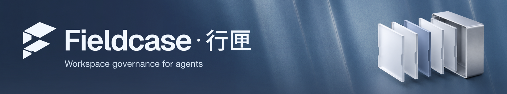

<h1 align="center">Fieldcase</h1>

<p align="center"><strong>给 Agent 一套可接续的工作区规则。</strong></p>

<p align="center">开源的工作区治理资源。规则、授权、进度和待办都记录在本地文件里。</p>

<p align="center">
  <a href="README.en-US.md">English</a> ·
  <a href="#quick-start">快速开始</a> ·
  <a href="#packs">资源包</a>
</p>

<p align="center"><code>0.1.0.0</code> · <a href="LICENSE">MIT</a></p>

<picture>
  <source media="(max-width: 720px)" srcset="cover/r4/fieldcase-banner-compact.png">
  
</picture>

## 快速开始 <a name="quick-start"></a>

### Agent 辅助自动安装

把下面整段复制给能联网和读写本地文件的 Agent。

```text
请带我开始使用 Fieldcase · 行匣 0.1.0.0。请先在一个独立的临时目录下载这两个文件。

ZIP
https://github.com/rainydesignstudio/fieldcase/releases/download/0.1.0.0/fieldcase-0.1.0.0-zh-CN-release-01.zip

校验清单
https://github.com/rainydesignstudio/fieldcase/releases/download/0.1.0.0/fieldcase-0.1.0.0-zh-CN-release-01-manifest.json

用清单中的 archive_sha256 校验 ZIP。校验通过后解包，读取包内 README.md，再按首用流程向我确认目标工作区和第一件小事。

本条授权在临时目录下载和解包。写入目标工作区须在方案审定后获我另行授权。
```

### 手动安装

1. 在 [0.1.0.0 发布页](https://github.com/rainydesignstudio/fieldcase/releases/tag/0.1.0.0) 下载同一语种的 ZIP 和校验清单。
2. 将 ZIP 的 SHA-256 与清单中的 `archive_sha256` 比对，一致后解包到独立目录。
3. 把包内 README、目标工作区目录和一件想先做的小事交给 Agent。

两种方式都需要 Agent 能读写所选本地目录。Agent 先核对目标和方案，获你授权后写入。采用 Git 时需有本地 Git。

## 资源包 <a name="packs"></a>

正式发布后，在项目 GitHub 仓库的 **Releases** 打开 `0.1.0.0`，选取同一语种的 ZIP 和校验清单。将 ZIP 的 SHA-256 与清单中的 `archive_sha256` 比对。每种语言的包都可独立使用。

<details>
<summary>核对 release-01 文件名</summary>

| 语言 | ZIP | 校验清单 |
|---|---|---|
| 简体中文 | `fieldcase-0.1.0.0-zh-CN-release-01.zip` | `fieldcase-0.1.0.0-zh-CN-release-01-manifest.json` |
| English | `fieldcase-0.1.0.0-en-US-release-01.zip` | `fieldcase-0.1.0.0-en-US-release-01-manifest.json` |

</details>

## 什么时候用

| 场景 | 怎么开始 |
|---|---|
| **🌱 从零新建** | 在空目标确认章程，从一个小任务开始。 |
| **📦 复制迁入** | 保留原工作区，到独立目标对齐目录、规则和入口。 |
| **🤝 接手已有工作区** | 给新会话实例目录，从实际交接找回规则、授权和未尽事项。 |

## 源码与实测

产品源码在 [中文母版](product/zh-CN/) 和 [英文母版](product/en-US/)。

首版实测覆盖空区开工、存量复制迁入、原位兼容和新会话接续。各例的具体范围见随包 README §5。Agent 从包内 README 开始，并按其中的入口找到 `AGENT-GUIDE.md` 和现行规范。

[MIT 许可](LICENSE) · Copyright 2026 Rainy
